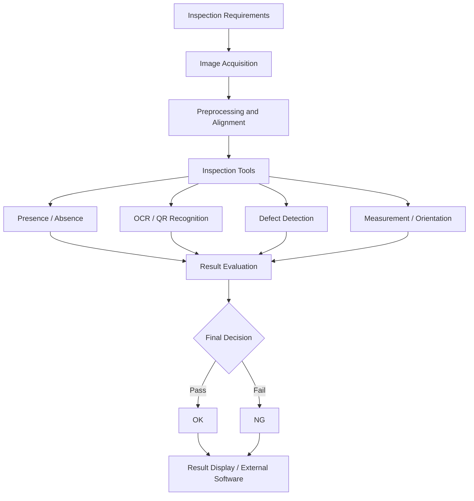

# Industrial Machine Vision & Software Engineering

### Industrial Inspection Systems | Machine Vision Algorithms | Software R&D

**Technical Portfolio — ABW Technologies, Malaysia | 2026**

**Menia Mollomou**  
BSc Computer Science (Data Science)  
Machine Vision & Software Development

---

## Project Overview

This repository documents selected engineering contributions from my industrial training at **ABW Technologies**, a company working on industrial machine vision and automated inspection solutions.

My experience covered two complementary areas:

1. **Industrial Machine Vision:** Developing, configuring, optimizing, and validating automated inspection solutions using Hikrobot VisionMaster.
2. **Software Engineering & R&D:** Contributing to industrial inspection software through Python, PySide6, C# WPF, and integration with licensed vision technologies.

The work involved real manufacturing inspection requirements, software development, iterative testing, troubleshooting, and collaboration with engineers during machine integration and production-related activities.

This repository is a technical case study of my contributions and engineering learning. It is not a release of company-owned software.

---

## Key Technical Contributions

### 1. Industrial Machine Vision Development

I developed complete inspection recipes using **Hikrobot VisionMaster**, combining multiple inspection operations into structured workflows.

My work included:

- Translating inspection requirements into vision-processing workflows.
- Configuring image acquisition and preprocessing operations.
- Using positioning, matching, fixtures, and Regions of Interest (ROIs).
- Developing inspections for scratches, dents, foreign materials, and other visible defects.
- Implementing presence/absence checks for screws, connectors, and components.
- Configuring OCR, QR-code recognition, orientation checks, and geometric measurements.
- Combining individual inspection results into final OK/NG decisions.
- Testing representative samples and investigating false calls and escapes.
- Optimizing inspection parameters and preparing recipes for machine integration.

I worked with both rule-based and AI-assisted inspection tools, selecting and adjusting techniques according to inspection requirements.

**Engineering focus:** Inspection accuracy, repeatability, workflow reliability, and systematic troubleshooting.

[Explore Machine Vision Documentation](machine-vision/overview.md)

### 2. Industrial Software Engineering & R&D

I also contributed to the development and improvement of industrial inspection software.

My work involved Python and PySide6 application development, inspection-related interfaces, reusable functionality, result handling, and software debugging.

Selected areas of contribution included:

- Camera acquisition and image-handling workflows.
- Inspection execution and result processing.
- Inspection interfaces and ROI interaction.
- Asynchronous result handling and request identification.
- Verification workflows and production-cycle consistency.
- Configuration and integration of inspection-related software modules.
- Testing, debugging, and investigation of unexpected software behavior.

The internal software platform was developed collaboratively. My contributions focused on selected modules, features, and engineering improvements rather than sole ownership of the entire application.

[Explore Technical Contributions](technical-contributions.md)

### 3. C# WPF and Hikrobot Technology Integration

As part of the broader industrial inspection software work, I used **C# and Windows Presentation Foundation (WPF)** for inspection-related desktop interface development.

This included work involving:

- Inspection interface components.
- Image and inspection-result visualization.
- Result summaries and verification-related interfaces.
- Software functionality operating within an environment that used Hikrobot DLL/SDK components.

This C# WPF experience was part of the industrial machine vision project, not a separate standalone application.

It complemented my Python/PySide6 development work and expanded my understanding of industrial desktop software and machine vision integration.

### 4. Testing, Validation & Troubleshooting

A significant part of my engineering experience involved improving the reliability of inspection solutions and software behavior.

I investigated issues related to:

- Incorrect ROI positioning and alignment.
- Image quality and acquisition conditions.
- False calls and missed defects.
- Inspection parameter sensitivity.
- Incorrect final decisions despite valid intermediate tool outputs.
- Unexpected inspection results and software workflow behavior.

My troubleshooting approach followed a systematic process:

**Observe → Reproduce → Isolate → Investigate → Correct → Retest → Verify**

One selected inspection validation documented during my internship achieved **zero false calls and zero escapes under the tested conditions**.

This was a specific test outcome, not a claim of universal accuracy or error-free production performance.

[Explore Engineering Challenges](engineering-challenges.md)

---

## Technical Skills & Technologies

| Area | Technologies and Concepts |
| --- | --- |
| Programming | Python, C#, C++ exposure |
| Desktop Development | PySide6, PyQt, WPF, Visual Studio |
| Machine Vision | Hikrobot VisionMaster, inspection recipes, ROI, fixtures, matching |
| Image Processing | Image acquisition, preprocessing, defect detection, measurement |
| Recognition | OCR, QR-code recognition, presence/absence, orientation |
| Vision Integration | Licensed Hikrobot DLL/SDK components, native software integration concepts |
| Software Engineering | Modular development, debugging, testing, result processing |
| Industrial Systems | Inspection result interfaces, production verification, PLC/communication concepts |
| Development Tools | Git, GitLab, GitHub, VS Code, Visual Studio |

**Scope clarification:** My direct work was concentrated on vision recipe development and selected software components. PLC, TCP/IP, and serial communication were areas of technical exposure and collaboration rather than integrations I independently owned end to end.

---

## Engineering Workflow

The following is a generalized representation of the industrial inspection workflow I worked with:

*Conceptual workflow only. Actual customer recipes, software architecture, parameters, and machine configurations are not disclosed.*

---

## Technical Documentation

This repository contains detailed technical documentation covering my contributions, engineering approaches, and lessons learned.

### Software Engineering

| Document | Description |
| --- | --- |
| [Technical Contributions](technical-contributions.md) | Selected software development contributions and their scope |
| [System Architecture](architecture.md) | Generalized architecture of the inspection software |
| [Engineering Challenges](engineering-challenges.md) | Software problems, investigations, and solutions |
| [Results & Lessons Learned](results-and-lessons.md) | Outcomes, engineering growth, and practical learning |

### Industrial Machine Vision

| Document | Description |
| --- | --- |
| [VisionMaster Overview](machine-vision/overview.md) | My work developing industrial inspection solutions |
| [Inspection Workflows](machine-vision/inspection-workflows.md) | Technical approach to multi-stage inspection recipes |
| [Challenges & Solutions](machine-vision/challenges-and-solutions.md) | Vision-specific troubleshooting and engineering lessons |

### Architecture Diagrams

| Diagram | Description |
| --- | --- |
| [Software Architecture](diagrams/software-architecture.svg) | Conceptual software components and their relationships |
| [Asynchronous Result Validation](diagrams/asynchronous-result-validation.svg) | Inspection result identity and validation |
| [Production Cycle Verification](diagrams/production-cycle-verification.svg) | Conceptual inspection verification workflow |

---

## Professional Skills Developed

This experience strengthened my ability to:

- Translate manufacturing requirements into technical inspection logic.
- Develop complete machine vision workflows.
- Investigate complex technical issues systematically.
- Build and improve desktop software components.
- Validate inspection results through repeated testing.
- Understand the relationship between algorithms, software, and industrial equipment.
- Work collaboratively in an engineering and production environment.
- Adapt to unfamiliar tools and technologies.

It also demonstrated how my Computer Science and Data Science background could be applied to practical industrial engineering challenges.

---

## Project Scope & Confidentiality

This repository is a **professional engineering portfolio and technical case study**.

It does not contain:

- Proprietary ABW Technologies source code.
- Customer-specific inspection recipes or configurations.
- Confidential production images or datasets.
- Internal SDK binaries, DLL files, or licensed components.
- Private customer, machine, or network information.
- Confidential performance records or deployment details.

All diagrams and workflow descriptions are generalized educational representations.

The work was completed within a collaborative engineering environment. Individual contributions are described without claiming sole ownership of the broader industrial software platform or complete machine integration.

---

## About Me

I am a Computer Science (Data Science) graduate with practical experience in industrial machine vision, automated inspection, and software development.

My interests include:

- Python software development.
- Computer vision and image processing.
- Industrial automation software.
- Data analysis and intelligent systems.
- Software engineering and technical problem-solving.

I am interested in opportunities where I can apply these skills to practical software, data, and computer vision challenges.

**GitHub:** [meniamollomou](https://github.com/meniamollomou)

---

*This repository documents selected technical experience gained during my industrial training at ABW Technologies, Malaysia, in 2026.*
