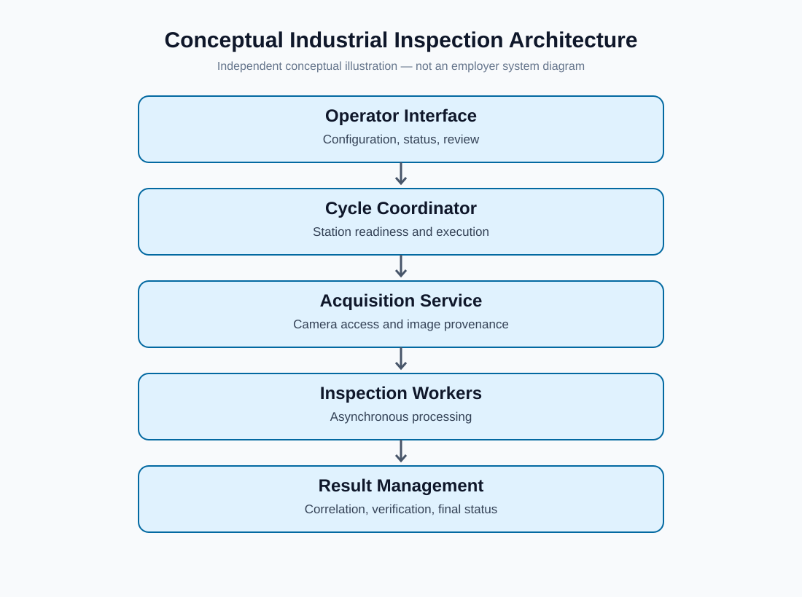
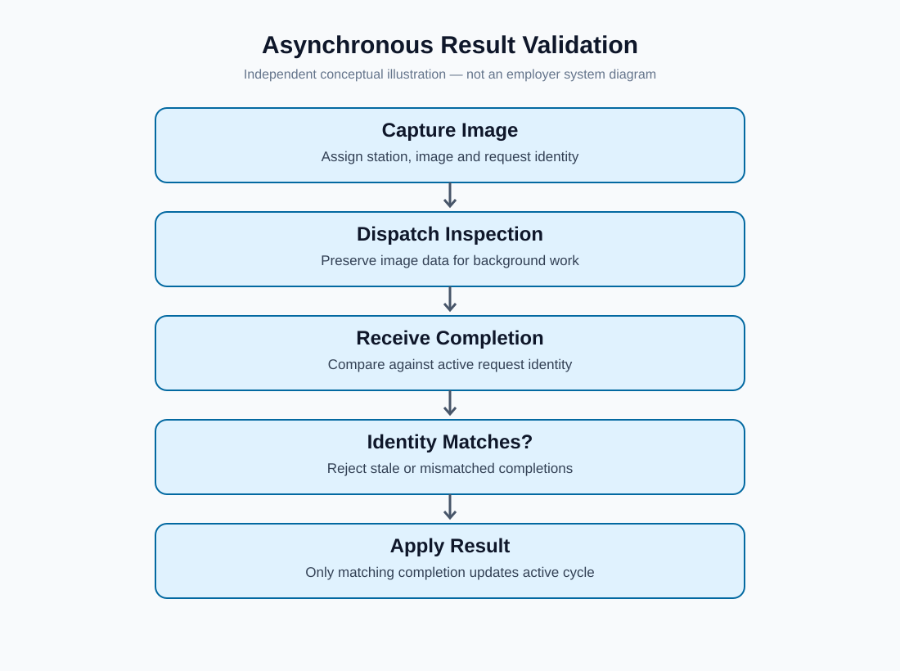
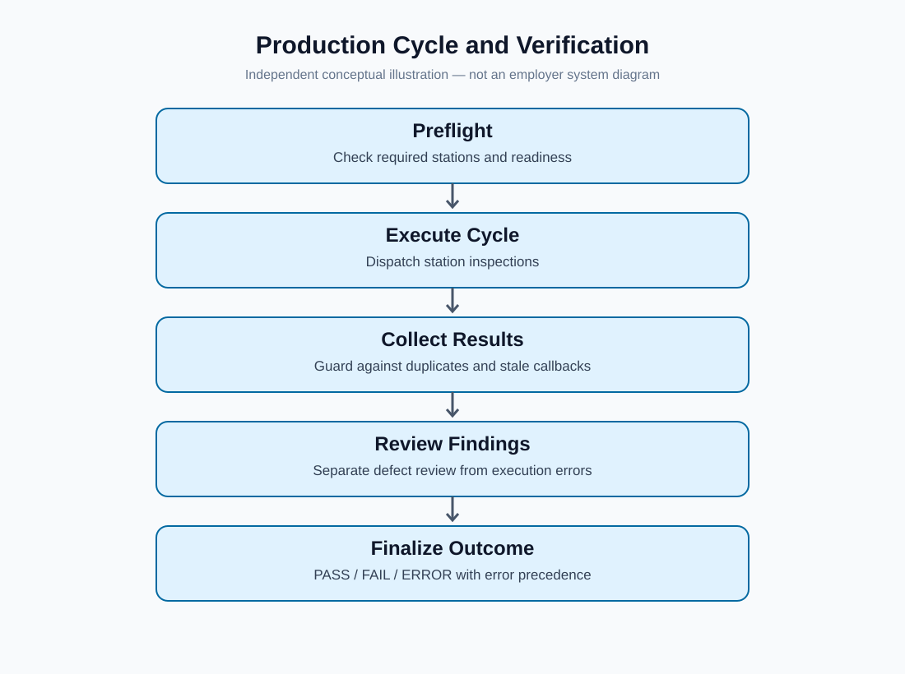

# System Architecture — Industrial Inspection Software

**Project:** Industrial Machine Vision & Automated Inspection Software  
**Experience:** ABW Technologies | 2026  
**Scope:** Conceptual description of a collaborative Python/Qt inspection application

> **Confidentiality note:** This is an original, simplified architectural model based on my engineering experience. It is **not** an employer system diagram, a reproduction of source code, or a specification of a deployed customer installation. Component names and boundaries are generalized. Implementation details, customer configurations, and proprietary inspection methods are intentionally excluded.

## 1. System at a glance

The application coordinated several responsibilities that must remain consistent during an inspection: acquiring an image, initiating inspection work, associating results with the correct request, presenting information for operator review, and determining the final execution outcome.

*Figure 1. Conceptual architecture showing the relationship between the operator interface, image acquisition, inspection execution, and result management.*

## 2. Architectural responsibilities

| Area | Responsibility | Why it matters |
| --- | --- | --- |
| Operator interface | Display readiness, execution state, images, and results | Operators need an accurate view of the current system state |
| Cycle coordination | Manage inspection requests and station participation | Prevents ambiguous or incomplete cycle completion |
| Acquisition | Manage camera access and provide image data | Reduces resource conflicts and clarifies acquisition failures |
| Inspection execution | Process submitted image data asynchronously | Keeps execution separate from UI responsiveness |
| Result correlation | Associate completions with the correct request and cycle | Prevents delayed or stale responses from contaminating a new run |
| Verification | Support review of inspection findings | Keeps human review distinct from execution health |
| Final outcome | Represent successful completion, detected failure, or execution error | Avoids treating an operational error as a passing inspection |

These are **conceptual responsibilities**, not claims that I authored each subsystem.

## 3. Important engineering boundaries

### Camera access versus image availability

A camera can be discovered or connected without being ready to provide a valid, fresh frame. Acquisition status, configuration readiness, and actual image availability therefore need to be treated separately. An unavailable source should produce a visible failure state rather than silently reuse an old image.

### Asynchronous execution versus current-cycle state

Background work may finish after the interface or production coordinator has advanced. A completion must be checked against the active station, image, and request context before its result is accepted. This protects the integrity of later inspection cycles.

*Figure 2. Generalized validation of asynchronous inspection results, including matching requests and rejecting stale or mismatched completions.*

### Inspection findings versus execution errors

A detected defect is an inspection outcome; an exception, missing result, or failed execution is a different category of event. Operator review can address reviewable findings, but it should not convert an execution error into a successful machine outcome.

## 4. Example of a generalized inspection cycle

1. The application checks that the requested stations and image sources are ready.
2. A station acquires or receives an image and retains context identifying the active request.
3. Inspection work is dispatched to background execution.
4. Returned results are checked for request identity, validity, and duplication.
5. Reviewable findings are presented through the verification workflow where applicable.
6. The application determines the cycle's final outcome, preserving execution errors.
7. The interface presents the outcome and returns to an appropriate next state.

This sequence illustrates engineering principles; actual customer workflows may differ.

*Figure 3. Generalized production inspection cycle, including readiness checks, result validation, operator verification, and final outcomes.*

## 5. My contribution within the architecture

I contributed to selected integration and reliability areas in an **existing team-developed application**, particularly:

- Camera acquisition ownership and station-facing integration.
- Image handoff and identity preservation for asynchronous inspection.
- Checks for stale or mismatched completion events.
- Production-cycle readiness and result-handling safeguards.
- Integration between inspection results, verification, and final status.
- Focused debugging and regression scenarios using controlled or synthetic test inputs.

My private development record distinguishes committed changes from additional local follow-up work. This document intentionally avoids implying that every described safeguard was deployed or that I built the full system independently.

## 6. Technology context

**Python · PySide6/Qt · NumPy · OpenCV · asynchronous execution · Git · focused regression testing**

Industrial cameras and inspection tools formed part of the broader working environment. This public overview does not disclose SDK internals, physical device settings, network topology, PLC addresses, or inspection recipes.

## 7. Related portfolio documents

- [Technical Contributions](technical-contributions.md) — selected implementation and integration work.
- [Engineering Challenges](engineering-challenges.md) — focused problem-solving cases.
- [Results and Lessons](results-and-lessons.md) — outcomes, limitations, and professional learning.

**Evidence boundary:** This architecture is a generalized educational representation. It does not establish production deployment status, system-wide test coverage, or numerical performance improvements.
