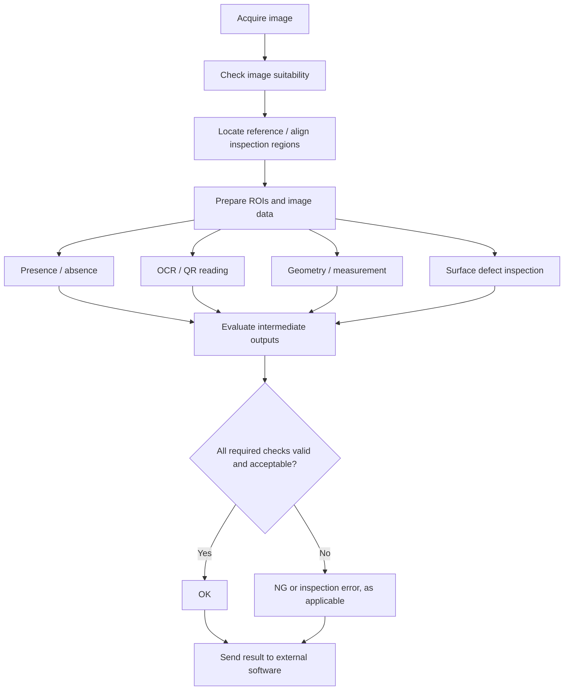

# Designing Multi-Stage Inspection Workflows in Hikrobot VisionMaster

**Experience:** R&D Software Intern — ABW Technologies, Malaysia (2026)  
**Focus:** VisionMaster recipe development, inspection logic, validation, and software result integration  
**Project type:** Industrial automated optical inspection (AOI)

> **Publication and attribution note:** This is a generalized technical case study based on my internship experience. It is not a customer recipe, an exported VisionMaster project, or a diagram of an actual production installation. No confidential images, thresholds, model files, hardware settings, customer identifiers, or production statistics are included. I developed inspection recipes and workflows;

## 1. Engineering objective

I built multi-stage inspection solutions **from a new VisionMaster solution**, combining several checks within a single recipe. Depending on the inspection requirement, a workflow could evaluate visual features, surface conditions, identification markings, and geometric characteristics before generating a combined **OK/NG** result.

My responsibility was to translate inspection requirements into a connected sequence of vision operations, configure and tune those operations, trace their outputs, and test the complete decision path. This was more involved than obtaining a correct result from an individual tool: the workflow also needed to use the correct image regions, pass data between steps, and produce a consistent final decision.

## 2. Generalized multi-stage workflow

*Figure 1. Original conceptual example of a combined inspection recipe. It is not a reproduction of an ABW or customer configuration. Branches and decision policies vary by application.*

## 3. How I developed a recipe

### A. Define the inspection criteria

I started by understanding what the inspection needed to detect, recognize, measure, or verify. For each check, I identified the relevant visual feature and the expected output: for example, whether a component was present, whether a marking could be read, or whether a visible surface anomaly should be flagged.

### B. Establish image acquisition and quality

Before tuning detection tools, I checked whether the acquired image showed the required features clearly. Lighting, exposure, focus, contrast, and variation in appearance could influence inspection behavior. When necessary, I used preprocessing operations to isolate or improve relevant information.

### C. Configure positioning, fixture, and ROIs

I selected reference features and used positioning or alignment operations when the inspected item could shift between images. I then created or adjusted regions of interest so downstream tools evaluated the intended areas. This was important because a fixed ROI could miss a feature if its position changed.

### D. Build inspection branches

I combined appropriate VisionMaster tools within the same solution. Examples of inspection tasks I worked on included:

| Inspection category | Purpose | Typical output to evaluate |
| --- | --- | --- |
| Presence / absence | Check for required components or visual features | Found / missing condition |
| OCR and QR | Read or verify identification information | Recognition or read result |
| Geometric measurement | Evaluate distances or other dimensional features | Measurement and acceptance condition |
| Orientation | Check whether a component or marking is correctly oriented | Orientation result |
| Surface inspection | Detect scratches, dents, or other visible abnormalities | Defect indication |

I worked with **rule-based methods and AI-based inspection tools**, selecting methods according to the visual task. The categories above describe the work I performed; they do not imply that every category was used in every recipe.

### E. Connect intermediate outputs to the final decision

Individual tools could return measurements, recognition outputs, or logical inspection results. I configured the flow between operations and checked that the combined decision reflected the required checks. I also traced intermediate outputs when the final OK/NG status did not match the apparent result of a particular inspection tool.

### F. Test, investigate, and refine

I tested representative images or units, reviewed incorrect classifications, and adjusted ROIs, tool parameters, or decision logic as needed. My investigation included both **false calls** (acceptable conditions marked defective) and **escapes** (defective conditions accepted). After changes, I repeated testing rather than relying on a single successful example.

### G. Prepare results for software integration

I worked on sending inspection results from VisionMaster to external software so the wider inspection application could use the outcome. I gained limited exposure to PLC, TCP/IP, and serial communication while teammates handled those integration areas more directly.

## 4. A representative debugging scenario: correct tool, incorrect final verdict

**Observed issue:** An individual inspection operation produced the expected output, but the overall inspection decision was incorrect.

**Investigation:** Rather than immediately retuning the detection algorithm, I examined the intermediate results and followed how values were passed into the downstream decision logic.

**Engineering response:** I reviewed the relationships between tool outputs, acceptance conditions, and the final verdict, then corrected the relevant configuration or logic where needed.

**Validation approach:** I reran representative cases to check both the individual inspection output and the combined result.

**Lesson:** A multi-stage inspection solution must be debugged as a connected system. A correct local detection does not guarantee a correct final decision.

*This is a generalized account of a troubleshooting pattern documented during my internship, not a claim about a specific customer defect or a quantified production improvement.*

## 5. Validation principles

The development process was iterative:

**Requirement → Configure → Test → Analyze errors → Tune → Retest → Integrate**

I considered image quality, ROI stability, parameter robustness, and consistency of the final decision. A successful test under selected conditions was evidence for those conditions only; it did not establish zero errors in every future production scenario.

## 6. What this work demonstrates

- End-to-end development of VisionMaster inspection recipes from a new solution.
- Combining multiple inspection branches into a single decision workflow.
- Applying positioning, alignment, ROI configuration, and parameter tuning.
- Working across conventional image-processing and AI-based inspection tools.
- Debugging intermediate outputs and final inspection logic.
- Evaluating false calls and escapes through iterative validation.
- Delivering inspection results for use by external software.

## Related documentation

- [Machine Vision Overview](overview.md) — scope of my VisionMaster experience.
- [Engineering Challenges](../engineering-challenges.md) — separate software reliability and debugging cases.
- [System Architecture](../architecture.md) — generalized Python/Qt application architecture.

**Evidence boundary:** This document describes my engineering activities and a conceptual workflow. It does not include proprietary recipes, actual inspection images, customer specifications, or claims of independent ownership of the entire industrial system.
